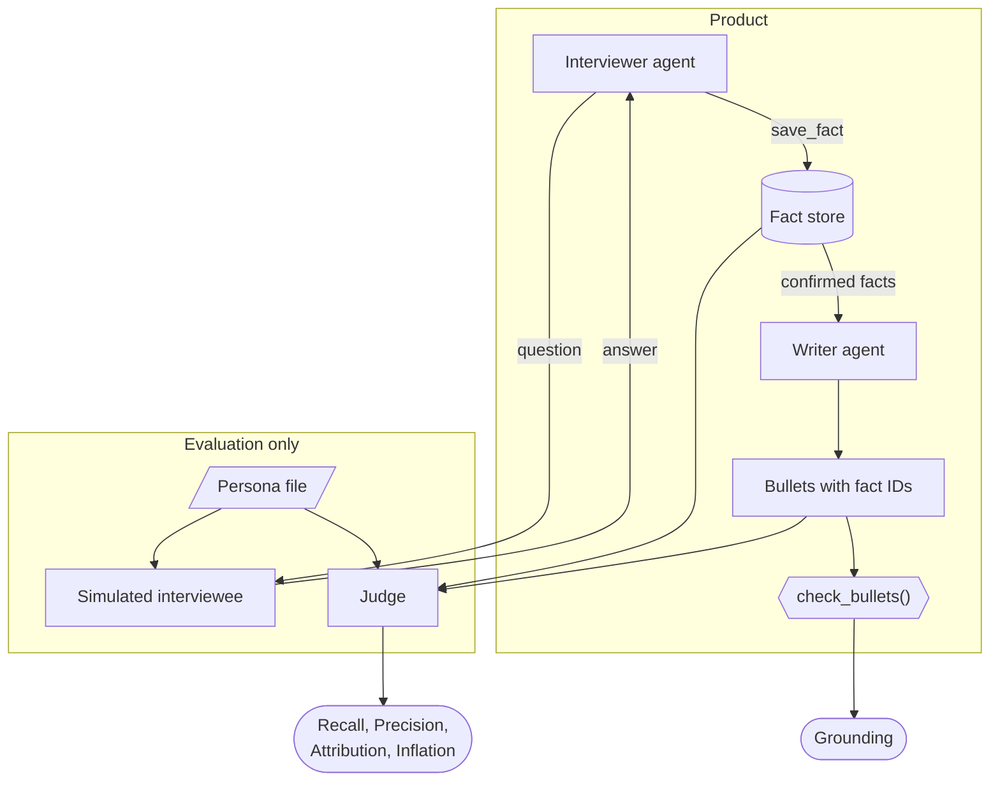
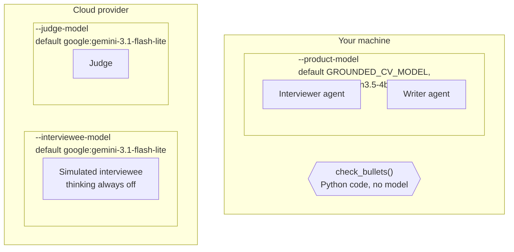

# grounded-cv

An agent that interviews a person about their work and writes CV bullets that cite only
what the person said. The project measures one thing: **does the agent stay faithful to
its source?**

## Results

**Example run, not a benchmark.** One persona (22 facts, 12 trap types), one
run per setup, a small judge. The run shows that the pipeline works end to end
and what the metrics catch. The differences between the two rows are not
evidence: a small model gives a different interview on each run.

Product: `qwen3.5-4b-16k` on Ollama (laptop CPU). Simulated interviewee: the
same model, thinking off. Judge: `gemini-3.1-flash-lite`. Persona:
`personas/p1_traps.json`, at most 8 questions.

| Product setup | Questions | Facts | Bullets | Recall | Precision | Attribution | Inflation | Grounding |
|---|---|---|---|---|---|---|---|---|
| Qwen, thinking on | 5 | 12 | 8 | 0.55 | 1.00 | 0.92 | 0.13 (1 status) | 1.00 |
| Qwen, thinking off | 5 | 24 | 4 | 0.86 | 0.83 | 0.75 | 0.50 (2 status, 1 actor, 1 technology) | 1.00 |

What the run shows:

- **The trap catches a real failure.** With thinking on, the interviewer stored
  a retry queue that was designed but never built as `confirmed`. The writer
  turned it into "Designed a retry queue for failed SMS reminders". The code
  check passed it; the judge marked it as a `status` failure.
- **Grounding alone says nothing about faithfulness.** With thinking off, the
  writer produced 4 role headings ("Software Developer at Example Rail Services
  (2015–2017)"), each citing 3 to 8 facts. All pass the code check.
- **Attribution fails without thinking.** With thinking off, the interviewer
  stored every fact with actor `me`, also "moved the clinic services to
  containers together with the backend team".
- **The judge makes mistakes.** In one verdict it names a fact that the bullet
  does not cite. It counts 4 stored role facts ("I worked as a Software
  Developer") as invented, which lowers Precision. Read the saved verdicts, not
  only the scores.

The result files are in [results/](results/). The next steps and the lessons
from building the project are in [docs/lessons.md](docs/lessons.md).

## How it works

The product has two agents and one deterministic check. The evaluation adds two more
model roles.



| Role | Kind | Sees | Produces |
|---|---|---|---|
| Interviewer agent | LLM, product | The conversation | Facts in the fact store |
| Writer agent | LLM, product | The confirmed facts | Bullets, each with fact IDs |
| `check_bullets()` | Code, product | Bullets and fact store | Pass or fail for each bullet, with the reason |
| Simulated interviewee | LLM, evaluation only | One persona file and the questions | Answers. "I don't know" when the file has no answer |
| Judge | LLM, evaluation only | Persona file, fact store, bullets | Matches between facts, and a verdict for each bullet |

The interviewer never sees the persona file. The persona file is the answer key.

## Worked example

One persona, two facts, from interview to metrics. All data is synthetic.

**1. Persona file** (seen only by the simulated interviewee and the judge)

| ID | Persona fact | Actor |
|---|---|---|
| P2 | The platform team moved the company's servers to the cloud. | `team` |
| P3 | I wrote the scripts that moved the customer database. | `me` |

**2. Interview**

> **Interviewer:** What was your part in the cloud move?
> **Simulated interviewee:** The platform team moved the servers. I wrote the scripts
> for the customer database.

**3. Stored facts** (the interviewer creates new IDs)

| ID | Action | Actor | Status |
|---|---|---|---|
| F1 | Moved the company's servers to the cloud | `team` | `confirmed` |
| F2 | Wrote the scripts that moved the customer database | `me` | `confirmed` |

**4. Bullets** (the writer cites fact IDs)

| Bullet | Cites |
|---|---|
| B1: Wrote the migration scripts for the customer database during a cloud move. | F2 |
| B2: Moved the company's servers to the cloud. | F1 |

**5. Scores**

| Metric | Result | Why |
|---|---|---|
| Grounding | 2 of 2 | Both bullets cite facts that exist and are `confirmed`. Code checks this. |
| Recall | 2 of 2 | The judge matches F1 to P2 and F2 to P3. |
| Precision | 2 of 2 | Both stored facts match a persona fact. Nothing is invented. |
| Attribution | 2 of 2 | Both matched facts have the same actor as the persona fact. |
| Inflation | 1 of 2 | B2 has no subject, so on a CV it reads as personal work. F1 is team work. |

B2 passes the code check but fails the judge. This is the failure that the project
measures.

If the interviewer had stored F1 with actor `me`, Precision would still be 2 of 2: the
fact is not invented. Attribution would drop to 1 of 2.

## Metrics

| Metric | Question | Checked by |
|---|---|---|
| Recall | Did the interviewer collect the persona's facts? | Judge |
| Precision | Did the interviewer invent facts? | Judge |
| Attribution | Did the interviewer record who did the work correctly? | Judge |
| Inflation | Do the bullets claim more than the facts allow? | Judge |
| Grounding | Does each bullet cite facts that exist and are `confirmed`? | Code |

## Models

Each model role has its own option. The diagram shows the defaults of
`python -m grounded_cv.eval` and where each model runs.



The interviewer and the writer use the model's default thinking setting.
`--product-thinking-off` turns it off. The example run in [Results](#results)
sets `--interviewee-model ollama:qwen3.5-4b-16k`, so only the judge ran in the
cloud.

The code does not change between models.

| Role | Default model | Why |
|---|---|---|
| Interviewer and writer (the product) | Qwen3.5 4B on Ollama (local) | The product makes the most model calls: at least one for each answer, and more when it calls `save_fact`. The Gemini free-tier quota ran out during development runs. A local model has no quota and needs no API key. |
| Simulated interviewee | Gemini Flash Lite (cloud, free tier) | It only looks up answers, so a small cloud model is enough. To save the quota, run it locally with `--interviewee-model ollama:qwen3.5-4b-16k`, as the example run does. |
| Judge | Gemini Flash Lite (cloud, free tier) | The judge must be stronger than the product: a weak judge makes every metric noise. A Qwen 4B judge failed on 24 facts, because it did not return one match for each fact. |

Two more uses:

- **A real interview about your own career:** use a local product model. A real
  interview has no simulated interviewee and no judge. Real career data must not
  go to a cloud provider.
- **Claude Haiku (cloud, paid API):** optional, as a substitute when the Gemini
  quota runs out. It costs little per run, and the project does not need it.

The judge stays the same model in all runs, so that results from different product
models can be compared.

Limits of this choice:

- The results table compares one product model with thinking on and off. It does
  not yet compare a local product model with a cloud product model.
- The local product model is slow on a laptop CPU: one interview takes 15 minutes or
  more, and up to 2 hours with thinking on.
- The Gemini free tier has a quota. When the quota runs out during the judge
  step, the result keeps the interview with a `judge_error`. Run
  `--rejudge` after the quota resets.
- Free-tier data can be used by the provider to train its models. The committed data is
  synthetic, so this is acceptable here. Do not send real career data to it.
- A small local model may fail tool calls more often. That failure is part of what the
  evaluation measures.

## Glossary

| Term | Meaning |
|---|---|
| Fact | One sentence about one piece of work, with its employer, role, period, actor and status. |
| Stored fact | A fact that the interviewer saved. IDs start with `F`. |
| Persona | A synthetic person used for evaluation. |
| Persona fact | A fact in a persona file: the ground truth. IDs start with `P`. |
| Actor | Who did the work: `me`; `team`, a group that includes the person; `colleague`, another person or group, without the person. |
| Status | `confirmed`: the person stated it clearly. `to_confirm`: the answer was vague. `do_not_claim`: it must not appear on the CV, for example a feature that was planned but never built. |
| Bullet | One CV line. It lists the IDs of the facts that support it. A bullet with no subject reads as first person. |
| Match | The judge's decision that a stored fact and a persona fact describe the same work. |
| Trap | A persona fact that invites inflation: a cancelled feature, another team's work, a vague answer about who did the work, or a confirmed fact with an exact limit (released but not in production, estimated but not measured). |
| Judge | A model that compares texts by meaning. It can be wrong. |

The reasons for each design choice are in [docs/decisions.md](docs/decisions.md).

## Limits

- The personas are synthetic and few.
- Recall, precision, attribution and inflation use a judge model, which can be wrong.
- The simulated interviewee can reveal hidden details too early or invent answers.
  Check the saved transcript before drawing conclusions.
- This first suite has one persona. It is not a representative benchmark.
- A saved transcript is not a full OpenTelemetry trace.

## Run

Install Python 3.13 and the project:

```bash
python -m pip install -e ".[dev]"
```

Start Ollama and create the local model once:

```bash
ollama pull qwen3.5:4b
ollama create qwen3.5-4b-16k -f ollama/Modelfile
```

The Modelfile sets a context of 16384 tokens. Ollama's default context of
4096 tokens is too small: the interview history and the model's thinking
fill it within a few questions. Check the context with `ollama ps` while the
model is loaded (column `CONTEXT`). The model needs about 3.7 GB of memory.

Put `GEMINI_API_KEY` in the environment or in a local `.env` file. Do not
commit the key. Then run:

```bash
python -m grounded_cv.eval
```

`--product-thinking-off` turns off thinking for the interviewer and the
writer. `--rejudge results/<file>.json --judge-model <model>` judges a saved
interview again and saves a new file, without a new interview.

The default product model is `GROUNDED_CV_MODEL` from the environment or
`.env`, or `ollama:qwen3.5-4b-16k` when it is not set. The simulated
interviewee and judge use `google:gemini-3.1-flash-lite`. Override them with
`--product-model`, `--interviewee-model` and `--judge-model`. Ollama uses
`OLLAMA_BASE_URL` when set and otherwise `http://localhost:11434/v1`.
Use only synthetic personas: the simulated interviewee and the judge can send their input
to a cloud provider.

Flash Lite was available for the first run, but it is a smaller judge. Its
verdicts need particular care when reviewed. Use a stronger judge when one is
available, and keep the judge fixed when comparing product models.

The command runs each JSON persona in `personas/` through Pydantic Evals and
saves a JSON result in `results/`. Each result includes the persona, model
names, prompt hashes, interview transcript, stored facts, bullets, check
results, judge explanations and scores. The question limit is 30 by default;
`--max-questions` changes it. Runs with different limits, personas, prompts
or judge models are not directly comparable.

Recall counts unique persona facts with a match. Precision and attribution
count stored facts; inflation and grounding count bullets. An empty
denominator is reported as `null`, not as a perfect score. Inflation counts
each failed bullet once; the breakdown counts every type the judge assigned.
The evaluation exits with an error if a case fails or the judge returns
missing, duplicate or unknown references.
